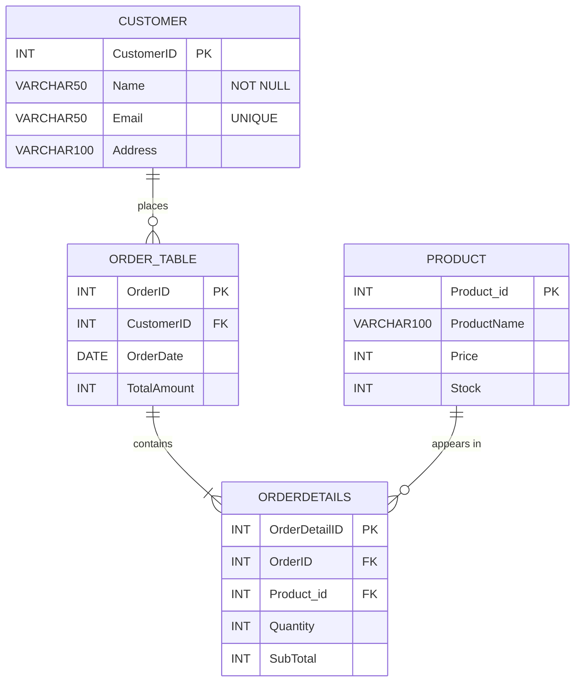
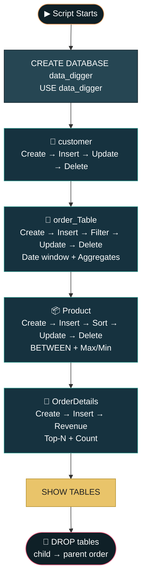

<div align="center">

```
██████╗  █████╗ ████████╗ █████╗
██╔══██╗██╔══██╗╚══██╔══╝██╔══██╗
██║  ██║███████║   ██║   ███████║
██║  ██║██╔══██║   ██║   ██╔══██║
██████╔╝██║  ██║   ██║   ██║  ██║
╚═════╝ ╚═╝  ╚═╝   ╚═╝   ╚═╝  ╚═╝

██████╗ ██╗ ██████╗  ██████╗ ███████╗██████╗
██╔══██╗██║██╔════╝ ██╔════╝ ██╔════╝██╔══██╗
██║  ██║██║██║  ███╗██║  ███╗█████╗  ██████╔╝
██║  ██║██║██║   ██║██║   ██║██╔══╝  ██╔══██╗
██████╔╝██║╚██████╔╝╚██████╔╝███████╗██║  ██║
╚═════╝ ╚═╝ ╚═════╝  ╚═════╝ ╚══════╝╚═╝  ╚═╝
```

[](https://git.io/typing-svg)


</div>

## 🧭 Table of Contents

[Overview](#-project-overview) • [Objective](#-objective) • [Database Design](#-database-design) • [Table Reference](#-table-reference) • [Features](#-features) • [Query Catalog](#-query-catalog) • [Script Flow](#-script-flow) • [Example Output](#-example-output) • [Video](#-Video) • [Skills Demonstrated](#-skills-demonstrated) • [Known Behaviors](#-known-behaviors--notes) • [Getting Started](#-getting-started) • [Project Structure](#-project-structure) • [Tech Stack](#-tech-stack)

---

## 📌 Project Overview

**DATA DIGGER** is a hands-on **MySQL** practice project that models a small **e-commerce database** — customers, their orders, a product catalogue, and the line items that tie orders to products. A single SQL script builds the `data_digger` database from scratch, populates it with sample data, and then "digs" into it with a progression of queries: **CRUD operations**, **filtering**, **sorting**, **date logic**, **aggregate functions**, and **grouped analytics**.

<div align="center">

| 🏗️ Schema | ✍️ CRUD | 🔎 Filter | 📅 Date Logic | 📊 Aggregates | 🧮 Group & Rank |
|:---:|:---:|:---:|:---:|:---:|:---:|
| 4 related tables | `INSERT` `UPDATE` `DELETE` | `WHERE` `BETWEEN` | `DATE_SUB` + `CURDATE` | `MAX` `MIN` `AVG` `SUM` `COUNT` | `GROUP BY` + `LIMIT` |

</div>

> Built as a **relational database & SQL fundamentals practice project.**
> *"Four tables, three keys, one script — dig out the insights."*

---

## 🎯 Objective

Design a normalized relational schema for a simple store and use it to practice the full life cycle of SQL work — from creating the database to answering real business questions such as *"What is our total revenue?"* and *"Which products sell the most?"*

Concepts demonstrated:

- **Schema design** — primary keys, `NOT NULL`, `UNIQUE` constraints, and foreign keys that enforce referential integrity
- **Normalization** — orders and products are linked through a junction-style `OrderDetails` table instead of repeating data
- **CRUD operations** — creating, reading, updating, and deleting rows across all four tables
- **Filtering & sorting** — `WHERE`, `BETWEEN`, `ORDER BY ... DESC`
- **Date functions** — rolling "last 30 days" windows with `DATE_SUB(CURDATE(), INTERVAL 30 DAY)`
- **Aggregation** — `MAX`, `MIN`, `AVG`, `SUM`, `COUNT`, and `GROUP BY` with `LIMIT` for top-N reporting
- **Clean teardown** — dropping tables in the correct dependency order so foreign keys never block cleanup

---

## 🧱 Database Design



**How it fits together:** one **customer** can place many **orders**; each order can contain many **line items** (`OrderDetails`); and each line item points to exactly one **product**. `OrderDetails` is the bridge that resolves the many-to-many relationship between orders and products.

---

## 🗂️ Table Reference

| Table | Primary Key | Foreign Keys | Purpose |
|---|---|---|---|
| `customer` | `CustomerID` | — | Stores customer name, unique email, and address |
| `order_Table` | `OrderID` | `CustomerID` → `customer` | One row per order, with date and total amount |
| `Product` | `Product_id` | — | Product catalogue with price and stock level |
| `OrderDetails` | `OrderDetailID` | `OrderID` → `order_Table`, `Product_id` → `Product` | Line items: which product, how many, and the subtotal |

**Constraints at a glance**

- `customer.Name` → `NOT NULL`
- `customer.Email` → `UNIQUE` (no two customers can share an email)
- `OrderDetails` → two foreign keys, so you can't reference an order or product that doesn't exist

---

## ✨ Features

**🏗️ Database Setup**
- `CREATE DATABASE IF NOT EXISTS` makes the script safe to re-run
- `SHOW DATABASES` and `SHOW TABLES` for quick inspection

**👤 Customer Management**
- Insert five sample customers, update an address, delete a record

**🧾 Order Management**
- Insert orders linked to customers, fetch a specific customer's orders, correct an order total, remove an order
- Pull orders from the **last 30 days** with a rolling date window

**📦 Product Catalogue**
- Insert products, list them by **price (high → low)**, update a price, delete a product
- Filter by price range with `BETWEEN`

**🧮 Sales Analytics**
- **Total revenue** across all line items
- **Top 3 best-selling products** by units sold
- **Times a product has been sold** (row count per product)
- **Highest / lowest / average** order amount, and **max / min** product price

---

## 📚 Query Catalog

### 👤 Customers

| Goal | Statement |
|---|---|
| Create table | `CREATE TABLE customer (...)` |
| Add customers | `INSERT INTO customer VALUES (...)` |
| View all | `SELECT * FROM customer;` |
| Change an address | `UPDATE customer SET Address = "Vadodara" WHERE customerID = 4;` |
| Remove a customer | `DELETE FROM customer WHERE customerID = 5;` |

### 🧾 Orders

| Goal | Statement |
|---|---|
| Create table with FK | `CREATE TABLE order_Table (... FOREIGN KEY (CustomerID) REFERENCES customer(CustomerID))` |
| View all | `SELECT * FROM order_Table;` |
| Orders of one customer | `SELECT * FROM order_Table WHERE CustomerID = 1;` |
| Fix a total | `UPDATE order_Table SET TotalAmount = 350 WHERE OrderID = 101;` |
| Cancel an order | `DELETE FROM order_Table WHERE OrderID = 105;` |
| Last 30 days | `WHERE OrderDate >= DATE_SUB(CURDATE(), INTERVAL 30 DAY)` |
| Highest / lowest / average | `SELECT MAX(TotalAmount), MIN(TotalAmount), AVG(TotalAmount) FROM order_Table;` |

### 📦 Products

| Goal | Statement |
|---|---|
| Create & seed | `CREATE TABLE Product (...)` + `INSERT INTO Product (...) VALUES (...)` |
| Most expensive first | `SELECT * FROM Product ORDER BY Price DESC;` |
| Update a price | `UPDATE Product SET Price = 140 WHERE Product_id = 2;` |
| Discontinue a product | `DELETE FROM Product WHERE Product_id = 1;` |
| Price range filter | `SELECT * FROM Product WHERE Price BETWEEN 500 AND 2000;` |
| Max & min price | `SELECT MAX(Price), MIN(Price) FROM Product;` |

### 🔗 Order Details & Analytics

| Goal | Statement |
|---|---|
| Items in one order | `SELECT * FROM OrderDetails WHERE OrderID = 101;` |
| Total revenue | `SELECT SUM(SubTotal) AS TotalRevenue FROM OrderDetails;` |
| Top 3 products by units | `GROUP BY Product_id ORDER BY TotalQuantitySold DESC LIMIT 3` |
| Times a product sold | `SELECT COUNT(*) FROM OrderDetails WHERE Product_id = 2;` |

### 🧹 Cleanup

```sql
DROP TABLE OrderDetails;   -- child tables first...
DROP TABLE order_Table;
DROP TABLE Product;
DROP TABLE customer;       -- ...parent tables last
```

---

## 🌊 Script Flow



| Step | Stage | Description |
|:---:|---|---|
| 1 | **Setup** | Create and select the `data_digger` database |
| 2 | **Customers** | Build the parent table first, then seed and modify it |
| 3 | **Orders** | Create the table that references `customer`, then query and aggregate it |
| 4 | **Products** | Build the independent catalogue table and practice sorting and filtering |
| 5 | **Order Details** | Create the bridge table that references both `order_Table` and `Product` |
| 6 | **Analytics** | Revenue, best-sellers, and sales counts |
| 7 | **Teardown** | Drop tables in reverse dependency order |

> 💡 Tables are created **parent-first** (`customer` → `order_Table` → `Product` → `OrderDetails`) and dropped **child-first** — this ordering is what keeps foreign key constraints happy.

---

## 🎬 Example Output

<details open>
<summary><b>▶ Customers after the update and delete</b></summary>

```
+------------+---------+-------------------+------------------+
| CustomerID | Name    | Email             | Address          |
+------------+---------+-------------------+------------------+
|          1 | Alice   | alice@gmail.com   | Surat            |
|          2 | Bob     | Bob@gmail.com     | Sun franchinsec  |
|          3 | Chrilce | chrilce@gmail.com | LONDON           |
|          4 | David   | David@gmail.com   | Vadodara         |
+------------+---------+-------------------+------------------+
```

</details>

<details open>
<summary><b>▶ Order amount statistics</b></summary>

```
+---------------+--------------+---------------+
| HighestAmount | LowestAmount | AverageAmount |
+---------------+--------------+---------------+
|          1200 |          350 |      722.5000 |
+---------------+--------------+---------------+
```

</details>

<details open>
<summary><b>▶ Total revenue</b></summary>

```
+--------------+
| TotalRevenue |
+--------------+
|         1259 |
+--------------+
```

</details>

<details open>
<summary><b>▶ Top-selling products by units sold</b></summary>

```
+------------+-------------------+
| Product_id | TotalQuantitySold |
+------------+-------------------+
|          2 |                 4 |
|          5 |                 3 |
|          3 |                 1 |   -- tied with Product 4; MySQL returns one of them
+------------+-------------------+
```

</details>

---

## Video

Video Link : https://drive.google.com/drive/folders/1QW5XMMq02IkAL0J_IVi1o0PEzHr73oNJ?usp=sharing

---

## 🎯 Skills Demonstrated

<div align="center">


</div>

- Designing related tables with primary keys, unique constraints, and foreign keys
- Writing `INSERT`, `UPDATE`, and `DELETE` statements with precise `WHERE` clauses
- Filtering with `BETWEEN`, sorting with `ORDER BY`, and limiting with `LIMIT`
- Using date functions (`CURDATE`, `DATE_SUB`) for rolling time windows
- Summarising data with `MAX`, `MIN`, `AVG`, `SUM`, `COUNT`, and `GROUP BY`
- Managing object dependencies when creating and dropping tables

---

## 📝 Known Behaviors & Notes

A few honest notes for anyone running or extending this script:

- **The `BETWEEN 500 AND 2000` product query returns an empty set:** no product in the sample data is priced in that range (prices run from 40 to 299, with the keyboard raised to 140), so the result is intentionally or accidentally empty. Adjust the range (e.g. `BETWEEN 50 AND 150`) to see rows.
- **`TotalAmount` is stored, not calculated:** values in `order_Table` are typed in by hand and don't match the sum of each order's `SubTotal` rows in `OrderDetails` (for example, order `101` is `350` but its line items add up to `320`). In a production design, the total would be derived from the details or kept in sync with a trigger.
- **The "last 30 days" query depends on today's date:** `CURDATE()` moves forward every day, so the sample orders dated October 2026 will eventually fall outside the window and the query will return nothing. Update the dates or use a fixed reference date for repeatable results.
- **Top-3 query has a tie:** products `3` and `4` both sold 1 unit, so the third row is not guaranteed. Add a tiebreaker such as `, Product_id ASC` to `ORDER BY` for deterministic output.
- **`COUNT(*)` counts rows, not units:** `TimesSold` for product `2` is the number of order lines (2), whereas the units sold are 4. Use `SUM(Quantity)` if you want units.
- **Deleting data that's referenced will fail:** removing a customer, order, or product that is still referenced by a child table raises a foreign key error. The script avoids this by deleting rows *before* dependent rows exist.
- **The script ends by dropping all four tables:** the `data_digger` database itself remains, but the data is gone. Remove or comment out the final `DROP TABLE` block if you want to keep the data for exploration.
- **Mixed naming conventions:** `order_Table`, `Product`, `Product_id`, and `CustomerID` use different casing styles. Table-name case sensitivity depends on your OS and MySQL settings, so keep spelling consistent when referencing them.

---

## 🚀 Getting Started

### Prerequisites

- [MySQL 8.0+](https://dev.mysql.com/downloads/) (or MariaDB — the script uses `DATE_SUB`, `CURDATE`, and `LIMIT`, all widely supported)
- A SQL client: MySQL Workbench, DBeaver, phpMyAdmin, or the `mysql` command-line client

### Installation

```bash
git clone https://github.com/<your-username>/data-digger.git
cd data-digger
```

### Usage

**Option 1 — Command line**

```bash
mysql -u root -p < data_digger.sql
```

**Option 2 — MySQL Workbench / DBeaver**

1. Open `data_digger.sql`
2. Run the script (⚡ Execute) — or run it **section by section** to watch each result
3. Inspect the output tabs for each `SELECT`

> 💡 **Tip:** For learning, execute the script in chunks (one table at a time) rather than all at once, so you can see each table before the cleanup block drops it.

---

## 📁 Project Structure

```
data-digger/
├── data_digger.sql    # Full script: schema, seed data, CRUD, analytics, cleanup
└── README.md          # Project documentation
```

---

## 🛠️ Tech Stack

- **Database:** MySQL 8.0+
- **Language:** SQL (DDL + DML + DQL)
- **Concepts demonstrated:** relational schema design, primary & foreign keys, constraints, CRUD, filtering & sorting, date functions, aggregate functions, `GROUP BY` / `LIMIT` analytics, dependency-ordered table teardown
